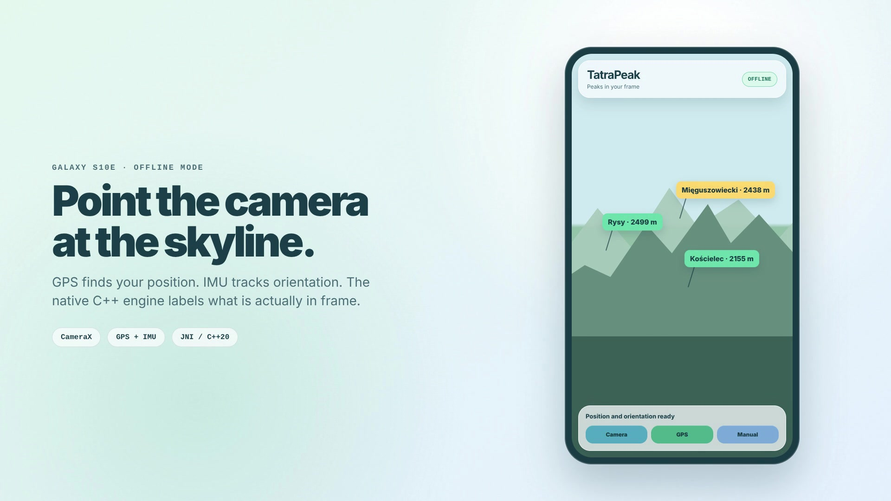

# TatraPeak

TatraPeak is a C++20 system for **geometric identification of mountain peaks**. Based on the observer's position, orientation, and camera parameters, it projects peaks onto an image and checks their visibility against a digital terrain model. The first complete dataset covers the Tatras.

The project does not use ML-based image recognition. Its results come from an explicit geodetic and optical model that can be tested independently of the phone.

## Demo

  

  <a href="https://youtu.be/S3GfYgYA3SI">▶ Watch the 20-second demo</a>

## What is ready

- portable C++20 core: WGS84, ECEF, ENU, quaternions and a pinhole camera;
- interpolated height raster and terrain occlusion evaluation;
- preparation and validation of Copernicus GLO-30, EGM2008 and OSM data;
- desktop rendering to JSON/SVG and deterministic replay session;
- reprojection error metrics and benchmarks for a photographic scene;
- versioned C ABI without exporting STL/Eigen types;
- Android application in Kotlin with CameraX, GPS, IMU, JNI and overlay;
- offline TATRAPK v1 with SHA-256 and validation before data transfer to C++;
- CI for Linux, Windows, macOS, Android, and iOS cross-builds.

[Example SVG overlay](examples/artifacts/synthetic-overlay.svg) ·
[Replay GIF](examples/artifacts/replay.gif) ·
[IMG_9553 quality report](examples/artifacts/quality-report-img9553.json)

## Architecture

Dependencies are directed inward. The core does not know about JSON, GeoTIFF, file system
or phone SDK. Adapters provide it with validated in-memory data.

~~~mermaid
flowchart LR
    RAW["DEM + geoid + OSM"] --> PREP["tatra-prepare"]
    PREP --> PACK["validated tatras-v1"]
    PACK --> IO["desktop IO"]
    PACK --> TPK["TATRAPK v1"]

    subgraph CORE["TatraPeak::core"]
        GEO["WGS84 / ECEF / ENU"]
        CAMERA["pinhole camera"]
        TERRAIN["GridTerrain"]
        VIS["visibility"]
        ENGINE["PeakEngine"]
        GEO --> ENGINE
        CAMERA --> ENGINE
        TERRAIN --> VIS --> ENGINE
    end

    IO --> CORE
    TPK --> ANDROID["Kotlin loader"]
    ANDROID --> JNI["JNI → C ABI"] --> CORE
    CORE --> RESULT["projections + visibility states"]
    RESULT --> SVG["JSON / SVG / metrics"]
    RESULT --> UI["overlay Android"]
~~~

| Layer | Responsibility |
|---|---|
| TatraPeak::core | geometry, camera, terrain, visibility, engine, time axis |
| TatraPeak::evaluation | pixel and degree reprojection error metrics |
| TatraPeak::io | JSON, GeoTIFF, SVG, manifest and data preparation |
| TatraPeak::mobile | stable, platform-agnostic C ABI |
| tatra | rendering and replay |
| tatra-prepare | DEM, OSM catalog, manifest and TATRAPK |
| android/ | CameraX, sensors, location, JNI and UI |

## How Frame Analysis Works

1. WGS84 positions are converted to ECEF and the local ENU frame.
2. The camera_from_enu quaternion moves the point into the camera frame.
3. Pinhole model calculates pixel: u = fx·x/z+cx, v = fy·y/z+cy.
4. The point receives a state of InFrame, OutsideFrame or BehindNearPlane.
5. For points in the frame, the observer-peak distance is sampled against DEM.
6. Visibility has an explicit state: VisibleInModel, OccludedInModel, Uncertain
   or MissingTerrain.

Geometry uses double because ECEF operates on values of the order of millions
of meters. Raster uses Float32 to limit memory, and interpolation goes to double.
A lack of terrain is a state, never an artificial height of zero.

The dataset owns the terrain and catalog. PeakEngine borrows them through const references, while FrameResult owns its data. C++ errors are returned as std::variant<T, Error>; the C ABI maps them to stable statuses and messages.

## Android

| Element | Configuration |
|---|---|
| Language | Kotlin 2.1.20 |
| Build | Gradle 8.11.1, AGP 8.9.2 |
| Android | minSdk 26, target/compileSdk 35 |
| Native | NDK 27.2.12479018, CMake 3.31.6, JNI |
| Camera | CameraX 1.4.2 + Camera2 interop |
| ABI | release: arm64-v8a; debug: also x86_64 for emulator |
| Target phone | Samsung Galaxy S10e |

The application does not assume cameraId="0". It selects the rear lens with a 20–35 mm equivalent focal length closest to 26 mm, requests 1× zoom, and tries to disable EIS/OIS. Intrinsics come from LENS_INTRINSIC_CALIBRATION or an explicit fallback using the focal length and sensor dimensions. Crop, rotation, and the PreviewView transform are represented as matrices and tested for rotations of 0/90/180/270°.

Orientation uses TYPE_ROTATION_VECTOR. An IMU sample must be within 25 ms of the frame timestamp; the transform accounts for device axes, SENSOR_ORIENTATION, buffer rotation, and magnetic declination. GPS provides WGS84 ellipsoidal height. A measurement is rejected after 15 s, when its XY error exceeds 30 m, or when its Z error exceeds 50 m. Manual positioning is also available.

Evaluate runs off the UI thread, up to 8 times/s, with backpressure. JNI has an exception barrier, opaque handles, and deterministic close. The interface shows the preview, labels, visibility states, GPS, manual position, and diagnostics. Recording saves up to 10 s / 100 frames in replay format; it does not record video.

The TATRAPK v1 package contains raster geometry, Float32 heights, a UInt8 mask,
a UTF-8 catalog, a manifest hash, and a whole-file hash. The current local package is 46 670 890 bytes and contains a 2160×4321 raster and 50 peaks. Large datasets are ignored by Git; without the package, the application runs a deterministic synthetic scene.

## Technologies

C++20, CMake, Ninja, CTest, Eigen, GeographicLib, GDAL, nlohmann/json,
GoogleTest, Kotlin, JNI, CameraX, Camera2, Android SensorManager,
LocationManager, SHA-256 and GitHub Actions.

C++ dependencies fetched through FetchContent are pinned to a revision and SHA-256.
GDAL and JSON belong solely to the optional desktop layer.

## Tests

Last local verification:

| Scope | Result |
|---|---:|
| C++ desktop-debug, including the real tatras-v1 dataset | **81/81** |
| C++ mobile-core, without GDAL/JSON | **34/34** |
| Android JVM/JNI Debug | **26/26** |
| Android JVM/JNI Release | **26/26** |
| Android assembleDebug and lintDebug | passed |
| APK of instrumentation tests | built |

Tests include geometry, image bounds, quaternions, terrain interpolation,
NoData, visibility, GeoTIFF/JSON/manifest validation, TATRAPK integrity,
deterministic replay, metrics, C ABI, JNI, intrinsics, orientation and GPS policy.
Public C++ headers are compiled separately, and CI also runs ASan/UBSan.

Instrumentation tests, camera calibration, sensor axes, and memory have not yet
been verified on a physical Galaxy S10e. The emulator does not replace this acceptance test.

## Trials and Performance

The first real-terrain test renders four directions from a simulated position and checks projection movement, coverage boundaries, and rays crossing a DEM tile boundary.

In the IMG_9553 photographic trial, peak elevation corrections reduced the errors for two control points from 254.60 to 65.57 px and from 193.36 to 92.68 px. The result shows the influence of elevation, but does not isolate errors in position, focal length, annotations, or DEM resolution. Full field validation remains open.

A benchmark of seven alternating pairs showed an **8.18%** median improvement in sampleHeight at a cost of 32 bytes per raster. Full evaluation remained effectively unchanged: **0.2444 → 0.2446 ms** on the test machine. A more complex cache, SIMD, and a custom allocator were therefore rejected.

## Quick Start

Prerequisites: C++20 compiler, CMake ≥3.28, and Ninja. The first configuration may download pinned dependencies; subsequent tests run offline.

~~~sh
cmake --preset debug
cmake --build --preset debug --parallel 2
ctest --preset debug
~~~

Demo generating result.json and overlay.svg:

~~~sh
cmake --preset desktop-release
cmake --build --preset desktop-release --target tatra-demo
~~~

Android requires JDK 17 or 21 and Android SDK. Open the android/ folder in Android Studio or run:

~~~sh
cd android
./gradlew test assembleDebug
./gradlew connectedDebugAndroidTest  # emulator or connected phone
~~~

APK: android/app/build/outputs/apk/debug/app-debug.apk.

## Limitations

- a known position, height, orientation, and camera calibration are required;
- the pinhole model does not correct for distortion, rolling shutter, or stabilization changes;
- DEM does not account for current trees, buildings, clouds, or snow;
- VisibleInModel refers to visibility in the model, not real-world observation;
- the CLI command tatra evaluate still lacks a complete JSON adapter;
- full field validation and acceptance on Galaxy S10e remain to be performed;
- the shared C ABI cross-compiles for iOS, but the Swift application does not yet exist.

## Repository Map

~~~text
include/tatra/        public C++ and C ABI contracts
src/                  portable core
adapters/desktop/     JSON, GeoTIFF, SVG, and data preparation
adapters/mobile/      platform-agnostic C ABI
apps/                 tatra and tatra-prepare programs
tests/                unit and integration tests
benchmarks/           measurements and the T19 report
android/              Kotlin/JNI application
examples/             inputs and public demo artifacts
docs/                 detailed stage reports and contracts
~~~

Detailed documents:
[C++ architecture](docs/MVP_PLAN.md),
[portability](docs/MOBILE_PORTABILITY.md),
[Android](docs/ANDROID_PROGRESS.md),
[TATRAPK format](docs/ANDROID_DATA_FORMAT_PROPOSAL.md),
[photographic trials](docs/T18_HEIGHT_TRIAL.md) and
[performance](docs/T19_PERFORMANCE.md).
